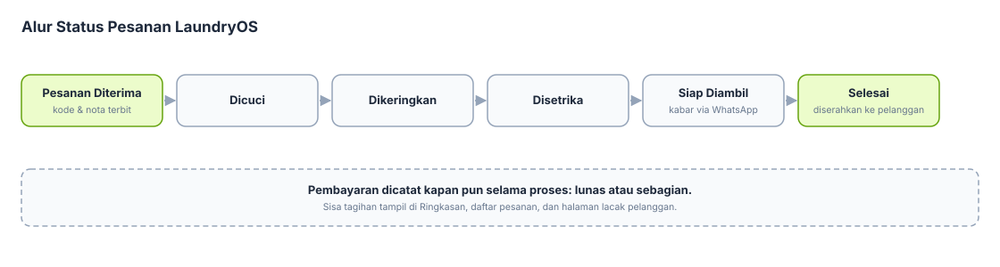
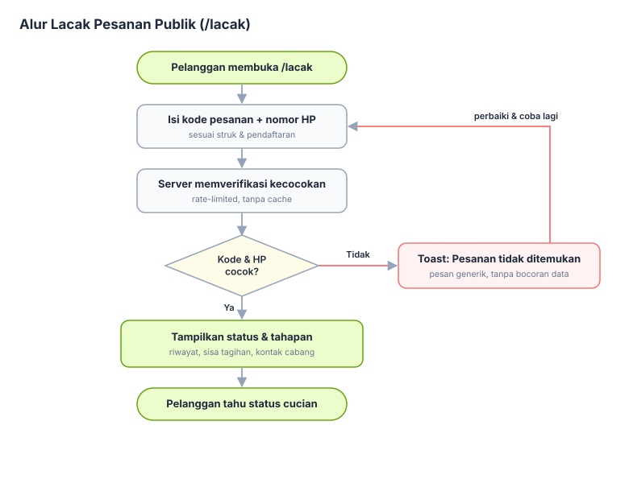
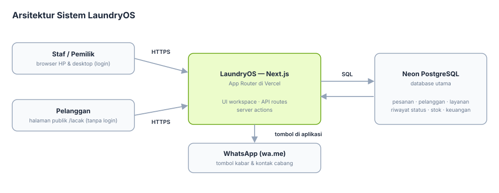

# LaundryOS

Sistem operasional laundry berbasis **Next.js App Router**, TypeScript, dan Tailwind CSS. UI memakai pola TypeUI yang ringkas, responsif, serta berfokus pada data dan alur kerja harian.


> **Status saat ini:** LaundryOS menyimpan transaksi dan data operasional per cabang di Neon. Fitur mencakup login/register, batas percobaan lintas instance melalui Neon, akses staf per cabang, ledger persediaan dan resep otomatis, estimasi HPP bahan, rekonsiliasi mutasi transfer/QRIS berbasis CSV dan konfirmasi manual, dashboard 7/30/90 hari, laporan lintas cabang, serta backup/restore manual. Tidak ada Blob, Cron, gateway pembayaran, atau WhatsApp API berbayar. Deploy menjalankan migrasi database sebelum build.

## Cakupan fitur lengkap

Daftar berikut adalah cakupan produk yang dituju. Status implementasi sebenarnya dirangkum setelah tabel ini.

| Modul | Fitur yang dituju |
| --- | --- |
| Dashboard | Ringkasan omzet dan jumlah pesanan; antrean per status; pesanan siap diambil dan belum lunas; tren periode; layanan terlaris; stok menipis; ringkasan per cabang. |
| Pesanan | Penerimaan cucian; layanan per kg/pcs/pasang; estimasi selesai; snapshot harga; status pengerjaan; riwayat perubahan; pembayaran penuh/parsial; pencarian, filter, pagination; nota cetak; pembatalan dan refund sesuai kebijakan. |
| Pelanggan | Profil dan kontak; pencarian; riwayat transaksi; frekuensi dan nilai transaksi; pencegahan duplikasi berdasarkan aturan nomor kontak; catatan preferensi dengan kontrol akses. |
| Layanan & harga | Katalog layanan per kg atau per item; harga, durasi, status aktif; layanan reguler/express; perubahan harga dengan snapshot agar invoice lama tetap akurat. |
| Persediaan | Katalog bahan; saldo dan batas minimum; resep konsumsi otomatis per layanan/tahap; pembelian/pemakaian/penyesuaian beralasan melalui ledger; peringatan stok menipis; histori pergerakan. |
| Keuangan | Pemasukan dan pengeluaran; metode pembayaran; tagihan belum lunas; pembayaran parsial; refund/reversal; rekap kas dan rekonsiliasi berdasarkan periode. |
| Laporan | Pemasukan tercatat, volume pesanan, pelanggan baru, layanan terlaris, dan metode pembayaran; filter tanggal; ekspor CSV berbasis periode. |
| Pengaturan & akses | Profil usaha dan cabang; akun staf; role, hak akses; audit log; pengaturan notifikasi dan preferensi aplikasi. |
| Operasional lintas modul | Multi-cabang; notifikasi status/pesanan siap; impor data; backup dan pemulihan; validasi server; aksesibilitas dan tampilan responsif. |

## Status implementasi

| Bagian | Tersedia sekarang | Belum tersedia |
| --- | --- | --- |
| Dashboard | Ringkasan pendapatan, antrean, pesanan terbaru, stok menipis, tagihan belum lunas, tren 7/30/90 hari; pemilik melihat ringkasan cabang yang dapat diakses | Peringatan otomatis melalui provider eksternal |
| Pesanan | Layanan kg/pcs/pasang, biaya express/antar dan diskon, snapshot harga, pagination, pembayaran parsial, pembatalan dan refund beralasan, nota dengan tautan `/lacak`, riwayat, ekspor CSV hasil filter, tautan WhatsApp manual | Notifikasi otomatis melalui provider WhatsApp/SMS/email |
| Lacak pesanan (publik) | Halaman `/lacak` untuk pelanggan: cek status, tahapan pengerjaan, riwayat status, dan sisa tagihan dengan kode pesanan + nomor HP terdaftar (rate-limited, tanpa login); nota cetak memberi alamat halaman lacak | Pesan pelacakan otomatis |
| Pelanggan | Tambah, cari, dan impor massal pelanggan dari CSV (validasi nomor, duplikat dilewati, laporan hasil per baris); ekspor CSV seluruh hasil pencarian; daftar Neon dibagi 25 pelanggan per halaman, ringkasan dihitung dari seluruh cabang, dan setiap pelanggan punya tautan ke riwayat pesanan | Profil lanjutan dan kontrol akses terperinci |
| Layanan & harga | Katalog per cabang; layanan kg/pcs/pasang; harga tersimpan sebagai snapshot pesanan; riwayat perubahan tercatat di aktivitas | Histori harga khusus dan aturan harga otomatis |
| Persediaan & keuangan | Ledger stok beralasan; resep pemakaian otomatis saat tahap pesanan yang dipilih; stok kurang menahan perubahan status; estimasi HPP; pembayaran/pengeluaran; refund dicatat terpisah; rekonsiliasi CSV manual dengan kecocokan nominal/metode/tanggal dan konfirmasi petugas | Rekonsiliasi otomatis via API penyedia pembayaran |
| Laporan | Rentang tanggal, perbandingan periode sebelumnya, layanan/pelanggan, berat/item, metode pembayaran, estimasi HPP bahan, ekspor CSV per periode, dan rekap pesanan/pemasukan semua cabang yang dapat diakses pemilik | Biaya tenaga kerja dan biaya tetap |
| Pengaturan & aktivitas | Profil dan pembuatan cabang, pilihan cabang aktif, akses Pemilik/Kasir/Operator, staf aktif/nonaktif dan akses staf lintas cabang, audit aktivitas utama | Supervisor, izin per tindakan yang dapat dikustomisasi, dan retensi audit lanjutan |
| Platform | Login/register, sesi bertanda tangan, pembatasan cabang dan peran di server, migrasi PostgreSQL, validasi request | Provider notifikasi otomatis, public API, dan observability terpusat |
| Backup & restore | Unduh dan pulihkan data cabang dalam transaksi, termasuk pembayaran, refund, harga tambahan, dan resep bahan (fitur Pro) | Backup dibuat manual lalu disimpan pemilik; tidak memakai penyimpanan berbayar tambahan |
| Prioritas pesanan | Dashboard menampilkan pesanan yang masih diproses dan targetnya hari ini atau sudah lewat sesuai zona waktu cabang, dengan tautan ke daftar pesanan | Pengingat otomatis |
| Riwayat pelanggan | Tautan dari daftar pelanggan ke seluruh pesanan pelanggan di cabang aktif, dengan pencarian, filter status, dan pagination | Profil pelanggan lanjutan |

Status rinci dan kriteria penerimaan ada di [docs/modules.md](docs/modules.md) dan [docs/roadmap.md](docs/roadmap.md). Pemakaian stok otomatis hanya berlaku jika pemilik sudah mengatur resep layanan; HPP adalah estimasi biaya bahan; rekonsiliasi hanya memberi pencocokan untuk dikonfirmasi petugas dan tidak mengubah ledger pembayaran; pesan WhatsApp dibuka sebagai tautan untuk dikirim oleh staf. Nama serta nomor kontak dalam fixture bersifat sintetis/masked.

## PRD dan flowchart

Dokumen kebutuhan produk lengkap tersedia di **[docs/prd.md](docs/prd.md)** — latar belakang, persona, kebutuhan fungsional (FR-01 s.d. FR-25), kebutuhan non-fungsional, model data ringkas, keputusan terbuka, dan riwayat versi.

Flowchart tersedia sebagai berkas **[draw.io](docs/flowcharts/laundryos-flowcharts.drawio)** (3 halaman diagram; buka dan edit di [app.diagrams.net](https://app.diagrams.net) atau ekstensi Draw.io Integration di VS Code). Pratinjau statisnya:

### Alur status pesanan



### Alur lacak pesanan publik



### Arsitektur sistem



## LaundryOS Pro

Fitur inti LaundryOS (pesanan, pelanggan, layanan, persediaan, keuangan dasar, dan lacak pesanan publik) **gratis dan terbuka (MIT)**. Fitur lanjutan dikunci sebagai **LaundryOS Pro** bagi pendukung Bali Tech Solution:

- **Ekspor laporan CSV**, **Tutup kasir harian**, dan **Backup & restore data** (daftar ini dapat berubah).

Cara mengaktifkan:

1. Dukung melalui [Trakteer](https://trakteer.id/bali_techsolution/support).
2. Anda menerima **kode aktivasi** (ditandatangani secara kriptografis, tidak dapat dipalsukan).
3. Buka **Pengaturan → LaundryOS Pro** di aplikasi, tempel kode, dan fitur Pro langsung terbuka. Kode dapat memiliki masa berlaku atau berlaku selamanya, sesuai dukungan.

## Dukungan

LaundryOS dikembangkan oleh **Bali Tech Solution**. Jika aplikasi ini membantu operasional laundry Anda dan Anda ingin mendukung pengembangannya, silakan beri dukungan melalui Trakteer:

**[Dukung pengembangan LaundryOS di Trakteer](https://trakteer.id/bali_techsolution/support)**

Tautan yang sama juga tersedia sebagai tombol "Dukung pengembangan" di sidebar aplikasi.

## Teknologi

- Next.js App Router dan React Server Components.
- TypeScript strict mode.
- Tailwind CSS v4 melalui plugin PostCSS.
- Zod untuk validasi domain.
- Lucide React untuk ikon.
- Pola controller → service → repository dipakai untuk alur operasional server.

## Menjalankan secara lokal

Persyaratan: Node.js **22** (lihat `.nvmrc`) dan npm.

```bash
npm install
npm run dev
```

Buka `http://localhost:3000`.

Perintah yang tersedia:

```bash
npm run lint
npm run typecheck
npm run build
```

`.env.example` berisi variabel untuk Neon. Modul operasional memakai Neon jika `DATABASE_URL` tersedia dan sesi `AUTH_SECRET` valid. Local development juga perlu `LAUNDRY_DATABASE_MODE=true`. Jangan masukkan rahasia ke `NEXT_PUBLIC_*`.

## Deploy ke Vercel + PostgreSQL (Neon)

Repository ini menyiapkan migrasi SQL, autentikasi email/password, dan implementasi PostgreSQL untuk modul operasional. Vercel menjalankan migrasi dan seeder demo yang idempoten sebelum build. Preview maupun Production memakai Neon bila `DATABASE_URL`, `AUTH_SECRET`, dan sesi valid tersedia; tanpa konfigurasi tersebut, data contoh hanya dipakai untuk pratinjau.

### Langkah deployment

1. Hubungkan repository `sulaksana23/laundry` ke Vercel dengan framework Next.js dan Node.js 22.
2. Tambahkan Neon PostgreSQL melalui integrasi Vercel Marketplace dan hubungkan resource ke environment Preview.
3. Pastikan `DATABASE_URL` dan `AUTH_SECRET` tersedia sebagai environment variable server-side untuk Preview. Buat `AUTH_SECRET` acak minimal 32 karakter; jangan menaruh rahasia di variabel `NEXT_PUBLIC_*`.
4. Build Vercel menjalankan migrasi SQL, lalu seeder demo secara idempoten sebelum build. Seeder dilewati jika akun demo belum terdaftar atau DATABASE_URL tidak tersedia; akun demo baru juga otomatis mendapat data saat registrasi.
5. Akses Preview melalui Vercel Authentication. Gunakan data uji sampai kebijakan backup dan audit siap.
6. Setelah deploy Production, akun dengan sesi valid memakai data Neon yang terisolasi menurut cabang.

### Lingkup database saat ini

Tabel cabang, pengguna, pelanggan, layanan, pesanan, histori status, pembayaran, persediaan, dan pengeluaran dibuat oleh migrasi. Modul operasional menyimpan data per cabang. Akun `demo@laundry.test` mendapat pelanggan, pesanan, pembayaran, persediaan, dan pengeluaran contoh saat didaftarkan; buat password sendiri pada formulir registrasi.

## Akun dan data demo

Daftarkan email `demo@laundry.test` melalui halaman registrasi dan pilih password sendiri. Saat akun demo dibuat, aplikasi mengisi cabangnya dengan pelanggan, pesanan, pembayaran, persediaan, dan pengeluaran sintetis. Akun serta password tidak ditanam sebagai kredensial bawaan di source code. Email lain mendapat cabang baru tanpa data contoh.

Jika akun demo sudah terdaftar sebelum fitur seed aktif, isi datanya sekali dengan `npm run db:seed:demo` setelah `DATABASE_URL` tersedia dan migrasi dijalankan. Seeder tidak menyimpan password dan tidak mengubah cabang yang sudah berisi data.

## Struktur direktori

```text
src/
├── app/                       # route, metadata, layout, global CSS
│   └── (workspace)/           # layar operasional
├── components/                # komponen UI dan layout bersama
├── features/                  # domain, data demo, dan UI per fitur
│   └── orders/
│       ├── domain/            # tipe, schema, aturan transisi
│       ├── data/              # fixture demo
│       └── components/        # UI interaktif pesanan
├── lib/                       # utilitas format dan class name
└── server/                    # pola controller/service/repository
docs/                          # spesifikasi dan standar teknis
```

## Dokumentasi proyek

| Dokumen | Isi |
| --- | --- |
| [Arsitektur](docs/architecture.md) | Batas layer, folder, dan alur request |
| [Pola controller-service-repository](docs/pattern-controller-service-repository.md) | Template implementasi per fitur |
| [Modul dan kriteria penerimaan](docs/modules.md) | Ruang lingkup modul dan definisi fitur |
| [Aturan domain](docs/domain-rules.md) | Status pesanan, pembayaran, stok, dan aturan yang perlu dikonfirmasi |
| [Rancangan database](docs/database.md) | Relasi PostgreSQL dan strategi migrasi |
| [Konvensi API](docs/api-conventions.md) | Bentuk endpoint, request, response, dan error |
| [UI TypeUI](docs/ui-typeui.md) | Token, tabel, formulir, modal, dan aksesibilitas |
| [Keamanan](docs/security.md) | Checklist sebelum rilis produksi |
| [Workflow pengembangan](docs/development-workflow.md) | Branch, commit, review, dan quality gate |
| [Roadmap](docs/roadmap.md) | Tahapan dari demo menuju sistem produksi |

## Lisensi

LaundryOS dilisensikan di bawah **[Lisensi MIT](LICENSE)**.

Copyright (c) 2026 **Bali Tech Solution**. Setiap orang boleh memakai, menyalin, mengubah, dan mendistribusikan perangkat lunak ini dengan syarat pemberitahuan hak cipta dan izin di atas tetap disertakan dalam setiap salinan — jadi nama Bali Tech Solution sebagai pembuat selalu tercantum.
