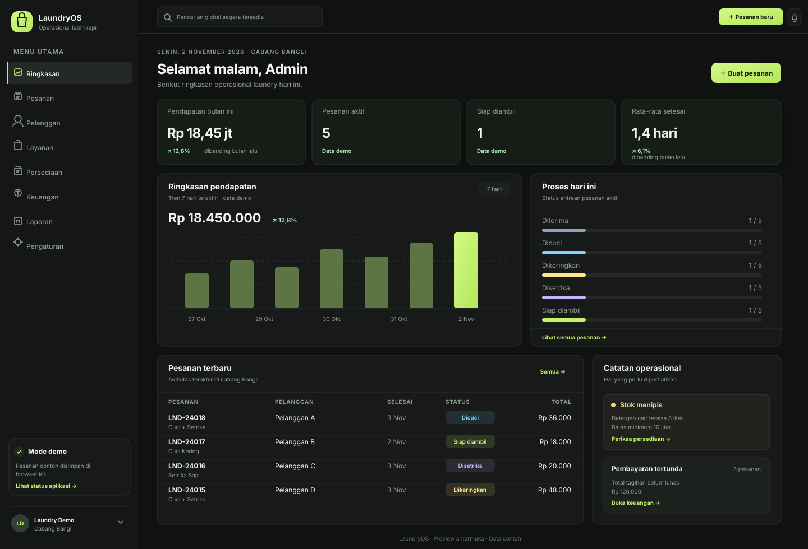

# LaundryOS

Sistem operasional laundry berbasis **Next.js App Router**, TypeScript, dan Tailwind CSS. UI memakai pola TypeUI yang ringkas, responsif, serta berfokus pada data dan alur kerja harian.



> **Status saat ini:** starter MVP untuk pengembangan. Modul tersedia sebagai UI; sebagian besar memakai fixture. Halaman Pesanan mendukung pembuatan pesanan dan perubahan status di `localStorage` browser. **Autentikasi, backend produksi, dan koneksi PostgreSQL belum diimplementasikan.** Jangan gunakan data contoh sebagai catatan transaksi nyata.

## Cakupan fitur lengkap

Daftar berikut adalah cakupan produk yang dituju. Status implementasi sebenarnya dirangkum setelah tabel ini.

| Modul | Fitur yang dituju |
| --- | --- |
| Dashboard | Ringkasan omzet dan jumlah pesanan; antrean per status; pesanan siap diambil dan belum lunas; tren periode; layanan terlaris; stok menipis; ringkasan per cabang. |
| Pesanan | Penerimaan cucian; data pelanggan dan item/layanan; berat atau satuan; estimasi selesai; harga dan diskon; status pengerjaan; riwayat perubahan; pembayaran penuh/parsial; pencarian, filter, pagination; nota cetak; pembatalan dan refund sesuai kebijakan. |
| Pelanggan | Profil dan kontak; pencarian; riwayat transaksi; frekuensi dan nilai transaksi; pencegahan duplikasi berdasarkan aturan nomor kontak; catatan preferensi dengan kontrol akses. |
| Layanan & harga | Katalog layanan per kg atau per item; harga, durasi, status aktif; layanan reguler/express; perubahan harga dengan snapshot agar invoice lama tetap akurat. |
| Persediaan | Katalog bahan; saldo dan batas minimum; penerimaan/penggunaan/penyesuaian melalui ledger; stok opname; peringatan stok menipis; histori pergerakan. |
| Keuangan | Pemasukan dan pengeluaran; metode pembayaran; tagihan belum lunas; pembayaran parsial; refund/reversal; rekap kas dan rekonsiliasi berdasarkan periode. |
| Laporan | Omzet, volume pesanan, status, pembayaran, layanan terlaris, pelanggan, pengeluaran, dan persediaan; filter tanggal/cabang; ekspor setelah hak akses dan definisi metrik ditetapkan. |
| Pengaturan & akses | Profil usaha dan cabang; jam operasional; konfigurasi layanan dan pembayaran; akun, role, hak akses; audit log; pengaturan notifikasi dan preferensi aplikasi. |
| Operasional lintas modul | Multi-cabang; notifikasi status/pesanan siap; impor data; backup dan pemulihan; validasi server; aksesibilitas dan tampilan responsif. |

## Status implementasi

| Bagian | Tersedia sekarang | Belum tersedia |
| --- | --- | --- |
| Dashboard | Ringkasan visual menggunakan data contoh | Query langsung dari database dan filter periode nyata |
| Pesanan | Cari/filter sederhana, validasi form, hitung total contoh, buat pesanan dan lanjutkan status di browser | Penyimpanan server, autentikasi, pembayaran, histori audit, pagination, nota |
| Pelanggan, layanan, persediaan, keuangan, laporan, pengaturan | Layar UI dan data fixture untuk demonstrasi | CRUD persisten, aturan bisnis server, laporan terverifikasi, akses berbasis role |
| Platform | Layout responsif, komponen UI, TypeScript strict, pola controller/service/repository | PostgreSQL, migrasi, API produksi, login, multi-cabang, backup, notifikasi |

Status rinci dan kriteria penerimaan ada di [docs/modules.md](docs/modules.md) dan [docs/roadmap.md](docs/roadmap.md). Nama serta nomor kontak dalam fixture bersifat sintetis/masked.

## Teknologi

- Next.js App Router dan React Server Components.
- TypeScript strict mode.
- Tailwind CSS v4 melalui plugin PostCSS.
- Zod untuk validasi domain.
- Lucide React untuk ikon.
- Pola controller → service → repository disiapkan untuk backend per modul.

## Menjalankan secara lokal

Persyaratan: Node.js **22** (lihat `.nvmrc`) dan npm.

```bash
npm install
npm run dev
```

Buka `http://localhost:3000`.

Perintah yang tersedia:

```bash
npm run lint
npm run typecheck
npm run build
```

`.env.example` berisi contoh `DATABASE_URL`, tetapi aplikasi saat ini **belum membaca variabel tersebut**. Jangan masukkan rahasia atau kredensial ke variabel `NEXT_PUBLIC_*`.

## Deploy ke Vercel + PostgreSQL (Neon)

Next.js dapat di-deploy langsung melalui integrasi Vercel. Untuk database PostgreSQL baru, Vercel menyediakan integrasi provider lewat Marketplace; Vercel Postgres lama tidak lagi tersedia untuk proyek baru. Neon merupakan salah satu pilihan Postgres Marketplace.

### Langkah deployment

1. Hubungkan akun GitHub ke Vercel, lalu impor repository `sulaksana23/laundry` sebagai proyek Next.js.
2. Gunakan root directory repository. Biarkan preset Next.js dan perintah build terdeteksi otomatis.
3. Tambahkan Neon Postgres melalui **Vercel → Storage/Marketplace**, lalu buat database dan hubungkan ke proyek.
4. Pastikan variabel koneksi database tersedia di environment **Production** dan **Preview** sesuai kebutuhan. Simpan rahasia hanya sebagai environment variable server, jangan commit ke Git.
5. Deploy branch `main`, lalu periksa deployment log dan halaman hasil deploy.

### Catatan penting sebelum memakai data usaha

Menghubungkan database saja belum membuat aplikasi ini menggunakan PostgreSQL. Repository saat ini belum memiliki schema/migrasi database atau implementasi repository PostgreSQL, dan pesanan demo masih disimpan di browser. Integrasi Neon, migrasi, API server, autentikasi, otorisasi, serta penggantian fixture perlu diselesaikan sebelum menerima data pelanggan atau transaksi nyata.

Panduan resmi: [Deploy Next.js di Vercel](https://vercel.com/docs/frameworks/nextjs), [Postgres Marketplace di Vercel](https://vercel.com/docs/marketplace-storage), dan [Neon di Vercel Marketplace](https://vercel.com/marketplace/neon).

## Struktur direktori

```text
src/
├── app/                       # route, metadata, layout, global CSS
│   └── (workspace)/           # layar operasional
├── components/                # komponen UI dan layout bersama
├── features/                  # domain, data demo, dan UI per fitur
│   └── orders/
│       ├── domain/            # tipe, schema, aturan transisi
│       ├── data/              # fixture demo
│       └── components/        # UI interaktif pesanan
├── lib/                       # utilitas format dan class name
└── server/                    # pola controller/service/repository
docs/                          # spesifikasi dan standar teknis
```

## Dokumentasi proyek

| Dokumen | Isi |
| --- | --- |
| [Arsitektur](docs/architecture.md) | Batas layer, folder, dan alur request |
| [Pola controller-service-repository](docs/pattern-controller-service-repository.md) | Template implementasi per fitur |
| [Modul dan kriteria penerimaan](docs/modules.md) | Ruang lingkup modul dan definisi fitur |
| [Aturan domain](docs/domain-rules.md) | Status pesanan, pembayaran, stok, dan aturan yang perlu dikonfirmasi |
| [Rancangan database](docs/database.md) | Relasi PostgreSQL dan strategi migrasi |
| [Konvensi API](docs/api-conventions.md) | Bentuk endpoint, request, response, dan error |
| [UI TypeUI](docs/ui-typeui.md) | Token, tabel, formulir, modal, dan aksesibilitas |
| [Keamanan](docs/security.md) | Checklist sebelum rilis produksi |
| [Workflow pengembangan](docs/development-workflow.md) | Branch, commit, review, dan quality gate |
| [Roadmap](docs/roadmap.md) | Tahapan dari demo menuju sistem produksi |

## Lisensi

Belum ditentukan. Tetapkan lisensi sebelum mendistribusikan atau menerima kontribusi eksternal.
