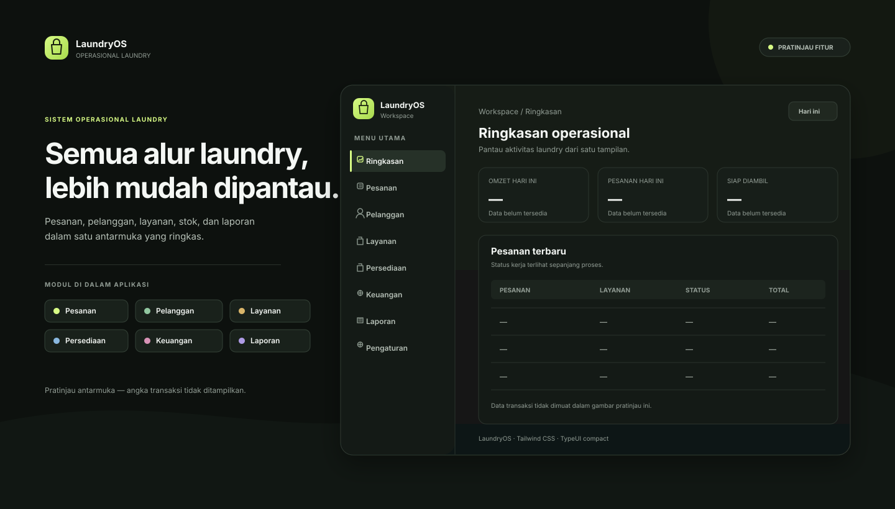

# LaundryOS

Sistem operasional laundry berbasis **Next.js App Router**, TypeScript, dan Tailwind CSS. UI memakai pola TypeUI yang ringkas, responsif, serta berfokus pada data dan alur kerja harian.



> **Status saat ini:** MVP. Modul Pesanan dapat memakai Neon PostgreSQL pada Vercel Preview dan local development setelah migrasi dijalankan; tanpa konfigurasi database, aplikasi memakai data demo di browser. Modul lain masih berupa UI/fixture. **Autentikasi, role, dan akses produksi belum tersedia.** Jangan masukkan data pelanggan nyata sebelum kontrol akses siap.

## Cakupan fitur lengkap

Daftar berikut adalah cakupan produk yang dituju. Status implementasi sebenarnya dirangkum setelah tabel ini.

| Modul | Fitur yang dituju |
| --- | --- |
| Dashboard | Ringkasan omzet dan jumlah pesanan; antrean per status; pesanan siap diambil dan belum lunas; tren periode; layanan terlaris; stok menipis; ringkasan per cabang. |
| Pesanan | Penerimaan cucian; data pelanggan dan item/layanan; berat atau satuan; estimasi selesai; harga dan diskon; status pengerjaan; riwayat perubahan; pembayaran penuh/parsial; pencarian, filter, pagination; nota cetak; pembatalan dan refund sesuai kebijakan. |
| Pelanggan | Profil dan kontak; pencarian; riwayat transaksi; frekuensi dan nilai transaksi; pencegahan duplikasi berdasarkan aturan nomor kontak; catatan preferensi dengan kontrol akses. |
| Layanan & harga | Katalog layanan per kg atau per item; harga, durasi, status aktif; layanan reguler/express; perubahan harga dengan snapshot agar invoice lama tetap akurat. |
| Persediaan | Katalog bahan; saldo dan batas minimum; penerimaan/penggunaan/penyesuaian melalui ledger; stok opname; peringatan stok menipis; histori pergerakan. |
| Keuangan | Pemasukan dan pengeluaran; metode pembayaran; tagihan belum lunas; pembayaran parsial; refund/reversal; rekap kas dan rekonsiliasi berdasarkan periode. |
| Laporan | Omzet, volume pesanan, status, pembayaran, layanan terlaris, pelanggan, pengeluaran, dan persediaan; filter tanggal/cabang; ekspor setelah hak akses dan definisi metrik ditetapkan. |
| Pengaturan & akses | Profil usaha dan cabang; jam operasional; konfigurasi layanan dan pembayaran; akun, role, hak akses; audit log; pengaturan notifikasi dan preferensi aplikasi. |
| Operasional lintas modul | Multi-cabang; notifikasi status/pesanan siap; impor data; backup dan pemulihan; validasi server; aksesibilitas dan tampilan responsif. |

## Status implementasi

| Bagian | Tersedia sekarang | Belum tersedia |
| --- | --- | --- |
| Dashboard | Ringkasan visual menggunakan data contoh | Query langsung dari database dan filter periode nyata |
| Pesanan | Cari/filter, validasi server, hitung harga dari katalog, buat pesanan dan lanjutkan status tersimpan di PostgreSQL pada Vercel Preview/local dev | Login/role, pembayaran, histori audit lengkap, pagination, nota |
| Pelanggan, layanan, persediaan, keuangan, laporan, pengaturan | Layar UI dan data fixture untuk demonstrasi | CRUD persisten, aturan bisnis server, laporan terverifikasi, akses berbasis role |
| Platform | Layout responsif, komponen UI, TypeScript strict, pola controller/service/repository, migrasi PostgreSQL untuk pesanan | Autentikasi, API produksi, multi-cabang, backup, notifikasi |

Status rinci dan kriteria penerimaan ada di [docs/modules.md](docs/modules.md) dan [docs/roadmap.md](docs/roadmap.md). Nama serta nomor kontak dalam fixture bersifat sintetis/masked.

## Teknologi

- Next.js App Router dan React Server Components.
- TypeScript strict mode.
- Tailwind CSS v4 melalui plugin PostCSS.
- Zod untuk validasi domain.
- Lucide React untuk ikon.
- Pola controller → service → repository disiapkan untuk backend per modul.

## Menjalankan secara lokal

Persyaratan: Node.js **22** (lihat `.nvmrc`) dan npm.

```bash
npm install
npm run dev
```

Buka `http://localhost:3000`.

Perintah yang tersedia:

```bash
npm run lint
npm run typecheck
npm run build
```

`.env.example` berisi variabel untuk Neon. Modul Pesanan memakai database di Vercel Preview jika `DATABASE_URL` tersedia; local development juga perlu `LAUNDRY_DATABASE_MODE=true`. Mutasi database sengaja dinonaktifkan di Vercel Production sampai autentikasi tersedia. Jangan masukkan rahasia ke `NEXT_PUBLIC_*`.

## Deploy ke Vercel + PostgreSQL (Neon)

Repository ini menyiapkan migrasi SQL dan implementasi PostgreSQL untuk modul Pesanan. Vercel menjalankan `npm run db:migrate` sebelum build jika Neon menyediakan `DATABASE_URL`. API database aktif pada local development yang dikonfigurasi dan Vercel Preview; mode Production tetap demo karena autentikasi belum tersedia.

### Langkah deployment

1. Hubungkan repository `sulaksana23/laundry` ke Vercel dengan framework Next.js dan Node.js 22.
2. Tambahkan Neon PostgreSQL melalui integrasi Vercel Marketplace dan hubungkan resource ke environment Preview.
3. Pastikan `DATABASE_URL` tersedia sebagai environment variable server-side untuk Preview. Jangan menaruhnya di variabel `NEXT_PUBLIC_*`.
4. Deploy branch `main`. Build menerapkan migrasi `db/migrations/001_initial.sql` dan seed katalog layanan demo.
5. Akses Preview melalui Vercel Authentication. Preview berisi data uji; jangan memasukkan data pelanggan nyata.
6. Production belum menggunakan database atau menerima mutasi transaksi sampai login, role, dan perlindungan data selesai.

### Lingkup database saat ini

Tabel cabang, pelanggan, layanan, pesanan, dan histori status dibuat oleh migrasi awal. Modul Pesanan membaca dan menyimpan pesanan ke PostgreSQL; pembayaran dimulai sebagai belum lunas. Dashboard dan modul lain masih menggunakan fixture/demo. Sebelum penggunaan operasional, lengkapi autentikasi, izin per cabang, audit, pembayaran, backup, dan kebijakan retensi.

## Struktur direktori

```text
src/
├── app/                       # route, metadata, layout, global CSS
│   └── (workspace)/           # layar operasional
├── components/                # komponen UI dan layout bersama
├── features/                  # domain, data demo, dan UI per fitur
│   └── orders/
│       ├── domain/            # tipe, schema, aturan transisi
│       ├── data/              # fixture demo
│       └── components/        # UI interaktif pesanan
├── lib/                       # utilitas format dan class name
└── server/                    # pola controller/service/repository
docs/                          # spesifikasi dan standar teknis
```

## Dokumentasi proyek

| Dokumen | Isi |
| --- | --- |
| [Arsitektur](docs/architecture.md) | Batas layer, folder, dan alur request |
| [Pola controller-service-repository](docs/pattern-controller-service-repository.md) | Template implementasi per fitur |
| [Modul dan kriteria penerimaan](docs/modules.md) | Ruang lingkup modul dan definisi fitur |
| [Aturan domain](docs/domain-rules.md) | Status pesanan, pembayaran, stok, dan aturan yang perlu dikonfirmasi |
| [Rancangan database](docs/database.md) | Relasi PostgreSQL dan strategi migrasi |
| [Konvensi API](docs/api-conventions.md) | Bentuk endpoint, request, response, dan error |
| [UI TypeUI](docs/ui-typeui.md) | Token, tabel, formulir, modal, dan aksesibilitas |
| [Keamanan](docs/security.md) | Checklist sebelum rilis produksi |
| [Workflow pengembangan](docs/development-workflow.md) | Branch, commit, review, dan quality gate |
| [Roadmap](docs/roadmap.md) | Tahapan dari demo menuju sistem produksi |

## Lisensi

Belum ditentukan. Tetapkan lisensi sebelum mendistribusikan atau menerima kontribusi eksternal.
