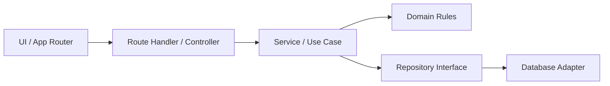

# Arsitektur Aplikasi

## Arah desain

LaundryOS menggunakan **modular monolith** dengan struktur feature-first. Satu aplikasi Next.js menangani UI, Server Actions, dan HTTP API; data operasional disimpan di Neon PostgreSQL dan dibatasi per cabang. Pendekatan ini menjaga deploy tetap sederhana untuk Vercel tanpa menambah layanan backend terpisah.

## Batas tanggung jawab

| Layer | Tanggung jawab | Boleh mengetahui |
| --- | --- | --- |
| `src/app` | Routing, metadata, layout, komposisi halaman, Route Handler | Next.js, feature entrypoint |
| `src/components` | Komponen tampilan yang dipakai lintas fitur | React, design token, prop UI |
| `src/features/<fitur>/domain` | Entity, value object, enum, aturan domain, schema input | Domain TypeScript/Zod |
| `src/features/<fitur>/application` | Use-case terpisah bila modul membutuhkannya; belum dipakai seragam | Domain, kontrak repository |
| `src/server/modules/<fitur>` | Service, controller, dan repository adapter; sebagian operasi workspace masih dikelompokkan | Next.js server API, Neon |
| `src/lib` | Utilitas generik seperti format dan class merge | Library kecil tanpa aturan usaha |

Pada mode produksi yang dikonfigurasi, autentikasi, pesanan, pelanggan, layanan, persediaan, keuangan, laporan, dan audit memakai Neon. Mode demo tetap tersedia saat database tidak aktif dan menggunakan fixture; data pada mode demo tidak tersimpan ke Neon. Sejumlah operasi halaman memakai Server Actions, sementara API HTTP ada di `src/app/api`.

## Alur request backend

1. Route Handler atau Server Action menerima input.
2. Adapter memeriksa format input, sesi, izin, dan schema; Route Handler juga menangani detail HTTP.
3. Service menjalankan use-case dan aturan domain.
4. Repository membaca/menulis data tanpa membocorkan detail database ke domain.
5. Adapter mengembalikan response sesuai kontrak endpoint. Bentuk response API belum diseragamkan; lihat [konvensi API](api-conventions.md).

Gunakan Server Component untuk data awal yang aman dibaca di server. Gunakan Client Component hanya untuk interaksi browser. Jangan mengimpor repository server, `server-only`, atau secret ke client bundle.

## Aturan dependency

- `domain` tidak mengimpor `next/*`, React, Prisma, SQL client, atau module UI.
- Pertahankan aturan usaha pada service/domain dan akses data pada repository atau modul server.
- Route Handler menangani batas HTTP, sesi, izin, validasi input, dan pemetaan response; query kompleks tidak diletakkan di komponen UI.
- Komponen UI tidak menentukan nominal final transaksi; server membaca harga aktif dan menghitung ulang nilai transaksi.
- Query operasional selalu menyertakan scope cabang yang berasal dari sesi yang tervalidasi.

Pemisahan layer belum seragam pada seluruh modul lama. Refactor dilakukan bertahap saat fitur disentuh agar perubahan struktur tidak mengganggu alur transaksi yang sudah dipakai.

## Strategi pertumbuhan

Pertumbuhan berikutnya sebaiknya mengikuti volume dan kebutuhan usaha: verifikasi akses lintas cabang, observability yang hemat kuota, kebijakan retensi data, dan proses backup/restore berkala. Integrasi pembayaran atau notifikasi otomatis hanya ditambahkan setelah provider, biaya, dan kebutuhan bisnis diputuskan. Hindari menduplikasi database atau menambah layanan terkelola sebelum ada kebutuhan terukur.
