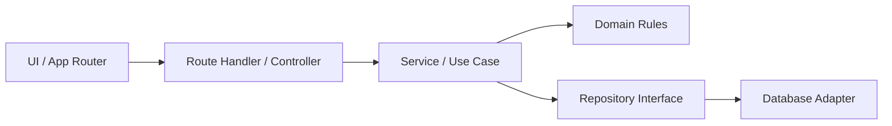

# Arsitektur Aplikasi

## Arah desain

LaundryOS menggunakan **modular monolith** dengan struktur feature-first. Satu aplikasi Next.js menangani UI dan HTTP API; tiap fitur menjaga domain dan use-case sendiri. Desain ini cukup ringan untuk satu usaha/cabang dan tetap memberi batas yang jelas ketika backend bertambah.

## Batas tanggung jawab

| Layer | Tanggung jawab | Boleh mengetahui |
| --- | --- | --- |
| `src/app` | Routing, metadata, layout, komposisi halaman, Route Handler | Next.js, feature entrypoint |
| `src/components` | Komponen tampilan yang dipakai lintas fitur | React, design token, prop UI |
| `src/features/<fitur>/domain` | Entity, value object, enum, aturan domain, schema input | Domain TypeScript/Zod |
| `src/features/<fitur>/application` | Use-case dan orkestrasi aturan | Domain, kontrak repository |
| `src/server/modules/<fitur>` | Controller HTTP, service, repository adapter | Next.js server API, persistence adapter |
| `src/lib` | Utilitas generik seperti format dan class merge | Library kecil tanpa aturan usaha |

Pada starter ini, halaman selain Pesanan memakai fixture. Halaman Pesanan menggunakan state browser untuk demo. Database dan API produksi belum disambungkan.

## Alur request backend

1. Route Handler menerima request HTTP dan mengirimkannya ke controller.
2. Controller memeriksa format HTTP, autentikasi, izin, dan schema input.
3. Service menjalankan use-case dan aturan domain.
4. Repository membaca/menulis data tanpa membocorkan detail database ke domain.
5. Controller memetakan hasil ke response API konsisten.

Gunakan Server Component untuk data awal yang aman dibaca di server. Gunakan Client Component hanya untuk interaksi browser. Jangan mengimpor repository server, `server-only`, atau secret ke client bundle.

## Aturan dependency

- `domain` tidak mengimpor `next/*`, React, Prisma, SQL client, atau module UI.
- `application` bergantung pada kontrak repository, bukan implementasi PostgreSQL.
- `infrastructure` mengimplementasikan kontrak dan dapat diganti tanpa mengubah domain.
- Controller tidak menjalankan query SQL dan tidak menghitung aturan usaha.
- Komponen UI tidak menentukan nominal final transaksi; server menghitung ulang saat backend aktif.

## Strategi pertumbuhan

Mulai dengan modul Pesanan dan Pelanggan. Setelah skema bisnis disepakati, tambahkan PostgreSQL, migrasi, autentikasi, lalu endpoint versi `/api/v1`. Baru setelah itu pindahkan mock state UI ke API dan tambahkan audit trail serta integrasi pembayaran/notifikasi.
