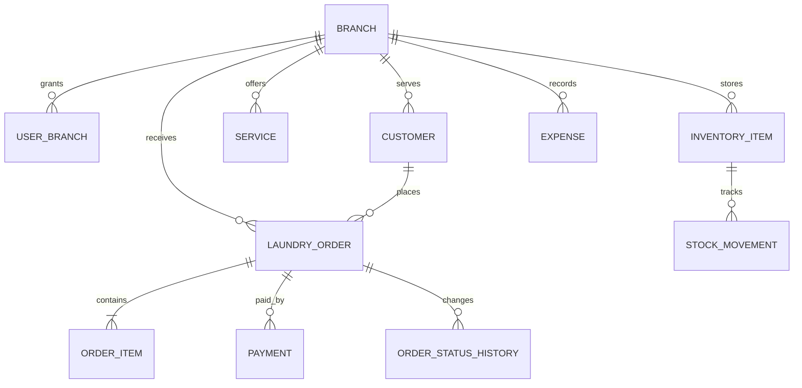

# Rancangan Database

## Status implementasi

Migrasi `db/migrations/001_initial.sql` membuat tabel cabang, pelanggan, layanan, pesanan, dan histori status. Modul Pesanan mempunyai repository PostgreSQL dan API baca/tulis. Migrasi dijalankan melalui `npm run db:migrate`; saat build Vercel, script `vercel-build` menjalankannya sebelum Next.js build bila `DATABASE_URL` tersedia.

Mode database aktif untuk local development bila `LAUNDRY_DATABASE_MODE=true`, dan untuk Vercel Preview bila Neon menyediakan `DATABASE_URL`. Mode Production tetap demo sampai autentikasi dan otorisasi selesai. Database awal hanya seed cabang dan katalog layanan sintetis; tidak ada data pelanggan contoh.

Skema yang aktif belum mencakup seluruh rancangan di bawah. Pembayaran, item beragam per pesanan, inventaris, pengeluaran, role, dan multi-cabang operasional masih perlu implementasi.

## Relasi konseptual

## Entitas minimum yang disarankan

- `Branch`: identitas cabang, zona waktu, alamat, status.
- `User` dan `UserBranch`: identitas akun dan role pada satu atau beberapa cabang.
- `Customer`: kontak pelanggan dengan scope cabang/tenant yang jelas.
- `Service`: kode, satuan, kebijakan harga, estimasi, status aktif.
- `LaundryOrder`: nomor order, pelanggan, cabang, tanggal terima/janji, total snapshot, status.
- `OrderItem`: layanan dan item yang dikerjakan beserta harga snapshot, kuantitas/unit.
- `Payment`: nominal, metode, status, reference provider, actor, waktu.
- `OrderStatusHistory`: status lama/baru, actor, waktu, catatan.
- `InventoryItem` dan `StockMovement`: master barang dan ledger pergerakan stok.
- `Expense`: kategori, nominal, metode, waktu, cabang, lampiran opsional.

## Keputusan skema

- Gunakan UUID/ULID untuk ID internal; nomor order adalah identifier bisnis terpisah dengan unique constraint per cabang/periode jika diperlukan.
- Tambahkan `createdAt`, `updatedAt`, dan actor pada tabel transaksi.
- Snapshot harga dan nama layanan pada order agar histori tetap benar setelah katalog berubah.
- Simpan nominal sebagai integer/bigint Rupiah setelah batas nominal disepakati.
- Gunakan `Decimal` hanya untuk berat/kuantitas bila perlu; tentukan skala presisi.
- Semua query baca/tulis dibatasi tenant/cabang pada repository.
- Pakai transaksi database untuk order + item + perubahan stok/pembayaran terkait.
- Tambahkan index sesuai query nyata: cabang + status + tanggal, pelanggan + tanggal, dan nomor order.
- Jangan menghapus transaksi pembayaran atau pergerakan stok; buat reversal yang terhubung ke record asal.

## Migrasi

1. Putuskan aturan domain dari `domain-rules.md`.
2. Buat schema/migrasi pertama dan seed data non-pribadi.
3. Uji constraint, tenant isolation, dan rollback di environment staging.
4. Siapkan backup dan prosedur restore sebelum data pelanggan masuk.
