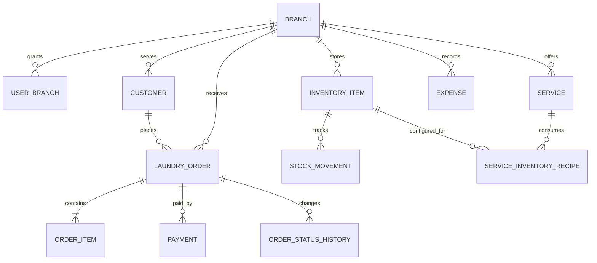

# Rancangan Database

## Status implementasi

Migrasi `db/migrations/001_initial.sql` sampai `013_professional_operations.sql` mencakup cabang, pengguna dan akses cabang, pelanggan, layanan, pesanan, pembayaran, refund, pengeluaran, persediaan, ledger stok, penutupan kas, audit, resep pemakaian bahan, batas percobaan bersama, snapshot biaya stok, dan rekonsiliasi mutasi CSV. Modul operasional memakai Neon dengan batas cabang; `npm run db:migrate` menerapkan migrasi, termasuk pada alur build Vercel.

Tabel `laundry_service_inventory_recipes` mengikat layanan, barang persediaan, tahap pemakaian, dan jumlah bahan per satuan layanan. Constraint gabungan menjaga agar layanan dan barang resep berasal dari cabang yang sama.

Migrasi 013 menambahkan rate limit bersama lintas instance, biaya stok dan pemakaian yang terkait pesanan, serta tabel impor/baris rekonsiliasi transfer dan QRIS. Baris rekonsiliasi hanya menyimpan saran pencocokan yang dikonfirmasi petugas; tabel itu tidak membuat atau mengubah pembayaran.

## Relasi konseptual

## Entitas utama

- `Branch`: identitas cabang, zona waktu, alamat, status.
- `User` dan `UserBranch`: identitas akun dan role pada satu atau beberapa cabang.
- `Customer`: kontak pelanggan dengan scope cabang/tenant yang jelas.
- `Service`: kode, satuan, kebijakan harga, estimasi, status aktif.
- `LaundryOrder`: nomor order, pelanggan, cabang, tanggal terima/janji, total snapshot, status.
- `OrderItem`: layanan dan item yang dikerjakan beserta harga snapshot, kuantitas/unit.
- `Payment`: nominal, metode, reference opsional, actor, waktu.
- `OrderStatusHistory`: status lama/baru, actor, waktu, catatan.
- `InventoryItem` dan `StockMovement`: master barang dan ledger pergerakan stok.
- `ServiceInventoryRecipe`: resep bahan per layanan dan tahap pengerjaan.
- `Expense`: kategori, nominal, metode, waktu, dan cabang.
- `ReconciliationImport` dan `ReconciliationRow`: berkas mutasi, nilai hash, baris, status pencocokan, serta pembayaran yang dipilih secara manual.
- `RateLimit`: hash kunci, jumlah percobaan, awal jendela, dan waktu pembaruan.

## Keputusan skema

- ID internal mengikuti kebutuhan tabel saat ini; nomor pesanan adalah identifier bisnis terpisah dan dibuat per cabang.
- Tambahkan `createdAt`, `updatedAt`, dan actor pada tabel transaksi.
- Snapshot harga dan nama layanan pada order agar histori tetap benar setelah katalog berubah.
- Simpan nominal sebagai integer/bigint Rupiah.
- Gunakan `Decimal` hanya untuk berat/kuantitas bila perlu; tentukan skala presisi.
- Semua query baca/tulis dibatasi tenant/cabang pada repository.
- Pakai transaksi database untuk order + item + perubahan stok/pembayaran terkait.
- Tambahkan index sesuai query nyata: cabang + status + tanggal, pelanggan + tanggal, dan nomor order.
- Jangan menghapus transaksi pembayaran atau pergerakan stok; buat reversal yang terhubung ke record asal.

## Migrasi

1. Periksa aturan domain di `domain-rules.md` sebelum mengubah transaksi.
2. Tambahkan migrasi baru yang dapat dijalankan ulang dengan skrip migrasi repository.
3. Pastikan setiap constraint/index dan perubahan kompatibel dengan data yang sudah tersimpan.
4. Jalankan migrasi melalui workflow build yang ada; jangan mengubah data pelanggan dalam seeder demo.
5. Unduh backup manual sebelum perubahan skema yang berisiko dan dokumentasikan langkah pemulihan.
